# OneSpec SDLC Studio

> **Autonomous Enterprise SDLC Engineering Workbench & ISO Compliance Platform**  
> *Built with Next.js 16 (Turbopack), React 19, TypeScript, Playwright, and Fastify.*

[](https://nextjs.org/)
[](https://react.dev/)
[](https://www.typescriptlang.org/)
[](https://playwright.dev/)
[](https://fastify.dev/)
[](https://www.iso.org/standard/45171.html)
[-red?style=flat-square)](https://www.iso.org/standard/62652.html)
[](https://www.iso.org/standard/56736.html)
[](https://www.iso.org/standard/43073.html)
[](https://www.iso.org/standard/78176.html)
[](https://owasp.org/www-project-api-security/)
[](https://opensource.org/licenses/MIT)

---

## 1. Executive Summary & Problem Statement (Ringkasan Eksekutif)

### [EN] English Overview
In enterprise environments operating without dedicated teams of Business Analysts, Technical Writers, QA Automation Engineers, or GRC Auditors, a single technical lead must bridge the entire software engineering and governance gap:
1. **Pre-Development Vacuum (Phase 1):** Early stakeholder meetings produce unstructured meeting notes (MoM). The lead must draft the BRD, PRD, BPMN 2.0 flowcharts, DFD Level-0/1 diagrams, and Bi-Directional RTM test matrices before a single line of backend or frontend code exists.
2. **Post-Development Black Box (Phase 2):** Developers deliver complex single-page apps (Vue/Nuxt, React/Next), microservices, and databases without documentation. The lead must reverse-engineer routes, API contracts, multi-persona RBAC matrices, and foreign-key integrity.
3. **GRC, Security & Formal Assurance (Phases 3 & 4):** Regulated industries require OWASP API Top 10 dynamic security scans, tamper-evident Merkle audit vaults, SMT Z3 formal logic verification, and Delphi ARB consensus sign-offs.

### [ID] Ringkasan Bahasa Indonesia
Dalam ekosistem enterprise yang tidak memiliki tim khusus Business Analyst, Technical Writer, QA SDET, dan Auditor Kepatuhan GRC, satu orang technical engineer dituntut memikul seluruh beban dokumentasi dan rekayasa pengujian:
1. **Vakum Pra-Development (Fase 1):** Rapat stakeholder hanya menghasilkan MoM mentah. Engineer harus menyusun BRD (StRS), PRD (SyRS), diagram alur BPMN 2.0 ber-swimlane, DFD Level-0/1, dan matriks RTM bi-directional sebelum koding dimulai.
2. **Black Box Pasca-Development (Fase 2):** Developer menyerahkan aplikasi SPA Nuxt/Vue/React tanpa dokumentasi teknis. Engineer harus membedah rute, kontrak API, skema basis data, dan matriks hak akses RBAC multi-persona.
3. **GRC, Keamanan & Verifikasi Formal (Fase 3 & 4):** Memenuhi standar ISO/IEC 27001, DAST OWASP API Security Top 10, pohon audit Merkle anti-tamper, pembuktian formal SMT Z3, dan konsensus Delphi ARB.

---

## 2. End-to-End Enterprise Architecture Flow (Alur Arsitektur End-to-End)

```mermaid
flowchart TD
    subgraph INGESTION["Quad-Modal Ingestion Hub (Step 01)"]
        M1["Mode A: Live Web URL (7-Layer Harvester)"]
        M2["Mode B: Guided Browser Session (Playwright CDP)"]
        M3["Mode C: Git Repository AST Parser"]
        M4["Mode D: Local Folder / ZIP / MoM Notes"]
    end

    subgraph CRAWLER["7-Layer Deep SPA Harvester 2.0"]
        L1["L1: Cross-Subdomain XHR/Fetch Body Sniffer"]
        L2["L2: Recursive walkJson Menu & Database ERD"]
        L3["L3: 3-Pass Accordion & Smooth Scroll Unfolder"]
        L4["L4: Vue/Nuxt Runtime Memory Router ($router)"]
        L5["L5: JS Production Chunk Regex Scanner"]
        L6["L6: Interactive Sidebar Non-Anchor Click Probe"]
        L7["L7: Sub-Tab/Modal Grepper & Instant CDP Screenshot"]
    end

    subgraph BRAIN["Domain Logic Brain & Formal Reasoning"]
        B1["Domain Intelligence (8 Enterprise Sectors)"]
        B2["Synthetic Data Factory (Indonesian Realia)"]
        B3["White-Box AST & DB Foreign Key Scenarios"]
        B4["SMT Z3 State Invariant & Guard Theorem Prover"]
    end

    subgraph EXPORT["ISO Library & Multi-Format Exporter"]
        E1["📊 Excel QA Workbook (.xlsx - 16 Sheets)"]
        E2["📘 Word User Manual (.docx - ISO 26514)"]
        E3["⚡ Playwright Test Suite (.spec.ts)"]
        E4["🚀 Postman Collection v2.1 (.json)"]
        E5["🛡️ Multi-Persona RBAC Differential Matrix (.json)"]
        E6["🔒 Merkle Audit Vault Snapshots (SHA-256)"]
    end

    INGESTION --> CRAWLER
    CRAWLER --> BRAIN
    BRAIN --> EXPORT
```



---

## 3. Modern Studio Workbench (4 Phases, 12 Steps)

The top navigation provides fast switching between the active **Studio Workbench**, the centralized **ISO Library**, and the 4 phases:

```
┌────────────────────────────────────────────────────────────────────────────────────────────────────────┐
│  1S OneSpec  [Project Switcher ▾] [+]   Studio | ISO Library (12) | P1: Pre-Dev | P2: Staging | P3: GRC | P4: Formal  │
└────────────────────────────────────────────────────────────────────────────────────────────────────────┘
```

```
PHASE 1: PRE-DEVELOPMENT
  ├── 01. Project Source & Ingestion Hub
  │     ├── Mode A · Autonomous Discovery (Run Autonomous Crawl)
  │     ├── Mode B · Guided Browser Session (Launch Guided Browser)
  │     └── Ingestion Tabs: Live URL, Git Repo (AST), .ZIP / Local Folder, Stakeholder Notes (MoM)
  ├── 02. Architecture & BPMN / DFD
  │     ├── ISO/IEC 19510 BPMN 2.0 Pool & Swimlane Modeler (UI vs API/DB, XOR Gateways)
  │     └── DFD Level-0 & Level-1 Interactive Process Graph
  ├── 03. Normative Specs (ISO/IEC/IEEE 29148:2018)
  │     ├── Business Requirements Document (BRD / StRS: BR-01..BR-n)
  │     └── System Requirements Specification (PRD / SyRS: REQ-US-01..n)
  └── 04. QA Workbook & Traceability (ISO/IEC/IEEE 29119:2022)
        ├── Bi-Directional RTM (BR-xx ➔ REQ-US-xx ➔ TC-xxx)
        └── Quick Export Toolbar (.xlsx, .docx, .spec.ts, .json, RBAC matrix)

PHASE 2: STAGING & AUTOMATION
  ├── 05. Quad-Modal Auto-Discovery (7-Layer Deep SPA Harvester 2.0)
  ├── 06. Spec-to-Code Gap Audit (PRD vs REA AST & DB Schema Conformance)
  └── 07. Live Runner & Bottlenecks (DOM ➔ Controller ➔ SQL SLA Telemetry Stream)

PHASE 3: GRC & SECURITY
  ├── 08. GRC, Risk & Merkle Vault (ISO/IEC 27001 Tamper-Evident SHA-256 Snapshots)
  └── 09. OWASP API Top 10 DAST (Automated BOLA, BFLA, Injection & CORS Scans)

PHASE 4: FORMAL ASSURANCE
  ├── 10. SMT Z3 Formal Proofs (State Transition & RBAC Guard Theorem Prover)
  ├── 11. Delphi ARB Consensus (Automated Architecture Review Board Scoring)
  └── 12. Executive Summary & Graph (Knowledge Graph & Multi-Artifact Export Hub)
```

---

## 4. 7-Layer Deep SPA Harvester 2.0

Enterprise Single Page Applications (especially Vue 2/3, Nuxt, and modern component frameworks) heavily obscure routes, authentication tokens, and backend APIs behind client-side state and multiple subdomains (e.g. `https://mobospace-sandbox.pancaran-group.co.id/` talking to `https://mobodfs-sandbox.pancaran-group.co.id/`).

OneSpec's Harvester (`src/services/deepSpaHarvester.ts`) deploys a 7-layer extraction pipeline:

1. **Cross-Subdomain XHR/Fetch Interceptor & Multi-Origin Sniffer:**  
   Captures network traffic across both target host and related backend subdomains without restrictive `/api/` filtering. Reads multi-origin hostnames from session cookies (`url_mobodfs`, origin cookies).
2. **Recursive JSON Walk (`walkJson`) & Nested Envelope Unpacker:**  
   Recursively traverses response bodies (`result.data`, `payload.data`, `response.data`, `items`, `rows`) to extract menu trees and infers `DatabaseErdTable` definitions with column data types (`INTEGER`, `DECIMAL`, `TIMESTAMP`, `VARCHAR`), primary keys, and foreign keys.
3. **3-Pass Recursive Sidebar Accordion Unfolder:**  
   Locates collapsible navigation groups (`[aria-expanded="false"]`, `.el-sub-menu__title`, `.v-list-group__header`), expands them in 3 passes, and executes vertical smooth-scrolling to trigger lazy DOM rendering.
4. **Vue / Nuxt Memory Router Extraction:**  
   Directly queries `$router.getRoutes()`, `$router.options.routes`, `window.__NUXT__`, and `window.$nuxt`. Recursively resolves parent/child route hierarchies with proper path prefixing (`parentPath + '/' + childPath`).
5. **Production JavaScript Chunk Scanner:**  
   Scans `/_nuxt/*.js`, `/_next/*.js`, and `/assets/*.js` chunk files with regex heuristics to uncover hidden, unlinked, or administrative route declarations.
6. **Interactive Sidebar Non-Anchor Click Prober:**  
   For navigation items without `<a href>` attributes (using `@click` handlers), performs safe programmatic clicks, monitors URL changes and DOM headers (`h1`, `h2`), and catalogs dynamic routes.
7. **Deep Per-Module Grepping, Sub-Tab Table Promotion & CDP Screenshot:**  
   Extracts form inputs, sub-tab tables (automatically promoting sub-tab `cols` and `rows` to the parent surface), action buttons with coordinate pins `(xPercent, yPercent)`, modal dialogs, and instant high-resolution screenshots via CDP (`Page.captureScreenshot`).

---

## 5. Multi-Persona RBAC Differential Matrix & Synthetic Data Factory

OneSpec automatically distinguishes authorization tiers and models differential access:

- **Personas Analyzed:**
  - `Pancaran Internal` (Full operational access, approval actions, financial views)
  - `Eksternal Partner` (Restricted partner portal, vendor vouchers, filtered data scope)
  - `Viewer / Auditor` (Read-only access, reporting, no mutation permissions)
  - `Unauthenticated` (Login surface boundary, 401/403 redirects)
- **Domain Logic Brain (`src/services/domainLogicBrainService.ts`):**  
  Classifies input fields into authentication gates (`AUTHENTICATION_RBAC_GATE`), applies `VR-AST-xx` white-box backend validation rules, and generates complete synthetic datasets:
  - Realistic Indonesian domain entities (NIK, Plat Nomor Kendaraan, NPWP, GUIDs, timestamps, currency amounts).

---

## 6. Export Engine & 100% Standalone Tool Parity

OneSpec generates industry-standard artifacts ready for immediate use in existing enterprise pipelines:

| Export Artifact | Standard / Specification | Output Format | Parity Details |
| :--- | :--- | :--- | :--- |
| **Excel QA Workbook** | ISO/IEC/IEEE 29119 | `.xlsx` & `.xls` (16 Sheets/Tables) | Complete traceability, test cases, data dictionary, bus factor, RBAC matrix, and CI/CD Automation bundle |
| **User Manual** | ISO/IEC/IEEE 26514:2022 | `.docx` (9 Sections, Bilingual `EN`/`ID`) | Visual SOP with 1:1 callout pins, step-by-step procedures, glossary, and error recovery matrix |
| **Playwright Suite** | Playwright Test Runner | `.spec.ts` | Executable E2E scenarios with self-healing locator chains & assertion gates |
| **Postman Collection** | Postman v2.1 Schema | `.json` | Full API endpoint collection with environment variables & test scripts |
| **RBAC Differential Matrix** | Enterprise GRC Schema | `.json` | Matrix of modules vs personas with permission levels (CRUD + Approve) |
| **BDD Specifications** | Cucumber / Gherkin | `.feature` | User stories & scenarios in Given-When-Then syntax |
| **Audit Snapshot Vault** | Merkle Tree Audit | `.json` | SHA-256 tamper-evident SDLC project snapshot for ISO/IEC 27001 compliance |

The **Quick Export Toolbar** (`src/components/shared/QuickExportToolbar.tsx`) provides 1-click access to these exports directly in **Step 04**, **Step 12**, and the **ISO Library**.

---

## 7. API Endpoints Reference

The Studio exposes clean HTTP REST endpoints for automated headless execution:

- `POST /api/sdlc/crawl`: Executes the 7-Layer Deep SPA Harvester, synthesizes full SDLC artifacts, and persists snapshots to the Workspace Vault.
- `POST /api/sdlc/discover`: Runs quad-modal discovery across Git repositories, local folders, or staging environments.
- `GET /api/sdlc/automation-bundle?format=playwright|postman|rbac`: Streams generated executable automation files.
- `GET /api/sdlc/vault`: Lists saved project workspaces, metadata, and snapshot diffs.
- `POST /api/export/document`: Generates `.xlsx`, `.docx`, or `.pdf` binary reports on demand.
- `POST /api/discovery/blind-crawl`: Probes target URLs for login forms, access types (`Pancaran` / `Eksternal`), and security headers.

---

## 8. Getting Started

### Prerequisites

- **Node.js:** v20.x or higher
- **Package Manager:** `pnpm` v10.x (recommended) or `npm`
- **Browsers:** Chromium installed via Playwright

### Installation

```bash
# Clone the repository
git clone https://github.com/Fairuza050894/OneSpec_.git
cd OneSpec_

# Install dependencies
pnpm install

# Install Playwright browser binaries
npx playwright install chromium
```

### Development Mode

Start both the Fastify backend server and Next.js Turbopack frontend concurrently:

```bash
pnpm dev
```

Or start the Next.js frontend individually:

```bash
pnpm dev:next
```

The application will be accessible at:
- **Studio Workbench:** `http://localhost:3000`
- **Fastify API Server:** `http://localhost:8080` (if running full dev suite)

### Headless Deep Harvest CLI

To run autonomous deep harvesting directly from the command line:

```bash
node scripts/deep-harvest-cli.mjs https://target-app.example.com
```

---

## 9. Verification & Quality Gates

Run the automated test and verification suite to ensure zero regressions:

```bash
# TypeScript compiler check (Zero errors allowed)
pnpm test:types

# Verify 16-sheet Excel QA Workbook structure
pnpm test:workbook-sections

# Verify Workspace Vault Merkle snapshot diffing
pnpm test:vault-diff

# Verify Product Knowledge AST & documentation parity
pnpm test:product-knowledge

# Verify Screenshot Guard & CDP capture engine
pnpm test:screenshot-guard
```

---

## 10. Strict Enterprise AI Guardrails

All development and AI agent operations in this repository strictly adhere to [`AGENTS.md`](./AGENTS.md):

1. **UI Architecture Lock:** `src/app/page.tsx` MUST ALWAYS use the Modern Studio Workbench UI (`Studio | ISO Library | P1: Pre-Dev | P2: Staging | P3: GRC | P4: Formal`). Never revert to legacy `F1..F4` tabs.
2. **Form Visibility:** Username, Password, and Access Type dropdown (`Pancaran` / `Eksternal`) must ALWAYS remain visible and editable in Step 01.
3. **Anti-Blank Screen:** `'use client';` must remain on Line 1 of all client components. Zero broken JSDoc comments.
4. **Zero TDZ & Zero Placeholders:** No temporal dead zone variable access. Complete `.map()` data bindings only; raw `// TODO` or `...more gates...` are strictly prohibited.

---

## 11. License

This project is licensed under the [MIT License](./LICENSE).  
Copyright (c) 2026 Fairuza Restu Chabita.
